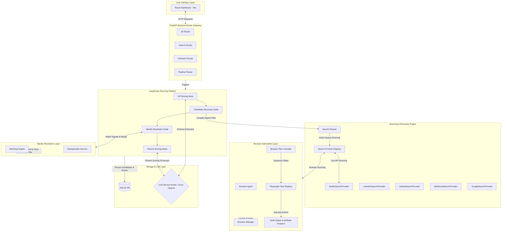

# Architecture Specification — AI Hiring Agent v2

The system orchestrates automated sourcing, data extraction, candidate identity resolution, and LLM-driven candidate evaluation from a single Job Description input.

---

## 1. System Architecture Diagram

---

## 2. Component Layer Specifications

### 2.1 Sourcing & Discovery Layer
* **Search Planner**: Decides the sequencing order of professional search providers. If an active Apollo key is present, it schedules Apollo first. Startup roles prioritize Wellfound.
* **Search Providers**: Wrap both direct API connectors (like Apollo's new `mixed_people/api_search` endpoint) and browser-driven search flows (using Google X-Ray, Indeed, and LinkedIn).
* **Candidate Discovery Coordinator**: Executes the planned searches, collects profiles URLs, and normalizes them (removing query parameters, standardizing domains).

### 2.2 Browser Automation Layer (Playwright)
* **Browser Agent**: Accepts specialized `SearchObjective` or `EnrichmentObjective` specifications and compiles them into a linear `BrowserPlan` of steps.
* **Task Registry**: Modular task implementations (e.g. `open_page`, `expand` see-more buttons, `extract_text` elements, `screenshot` logs).
* **DOM Helper**: Provides robust, headless locator selectors and supports attribute-level web scraping (such as links using selector `@href` syntax).

### 2.3 Identity Resolution Layer
* **Matching Engine**: Resolves candidate identities across fragmented data streams.
  * **Hard Signals**: Matches email addresses, LinkedIn URLs, or GitHub URLs (normalized) exactly, returning a confidence score of `1.0`.
  * **Soft Signals**: Employs a weighted string similarity algorithm (Name: 40%, Company: 30%, Title: 20%, Location: 10%) to estimate the probability that the profiles refer to the same person.
* **Deduplication Service**: Matches candidate profiles and merges overlapping records to preserve the richest details (combining skills, professional experiences, and certifications).

### 2.4 LLM & Configuration Layer
* **LLM Service Wrapper**: Handles token mapping, JSON generation formatting, and client routing for **Groq** (using `llama-3.1-8b-instant` for parsing and `llama-3.3-70b-versatile` for evaluation/outreach generation) and **OpenAI** (using `gpt-4o-mini` and `gpt-4o`).
* **Environment Config**: Active settings loaded dynamically from `backend/.env` (with `override=True` to clear cached shell variables).
