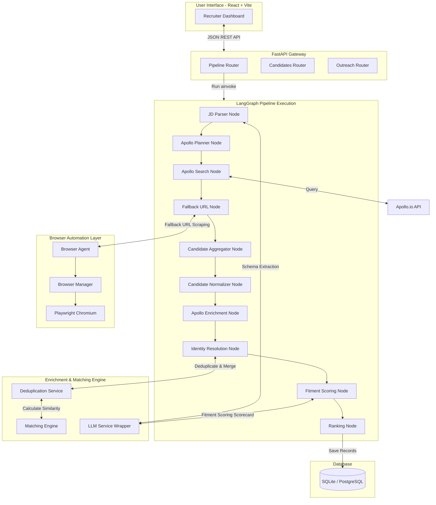

# Project Architecture & Structure — AI Hiring Agent v2

This document provides a comprehensive map of the project directories, files, and core architectural flows for the **AI Hiring Agent v2**.

---

## 1. High-Level System Architecture

The project is structured as a full-stack application containing:
*   **Vite/React Frontend**: A clean, single-page application dashboard structured into interactive recruiting stages.
*   **FastAPI Backend Router Gateway**: An asynchronous API server that handles candidate lifecycle states, parses job descriptions, schedules workflows, and triggers identity resolution.
*   **LangGraph Sourcing Pipeline**: A stateful workflow machine that orchestrates candidate search, browser-driven enrichment, duplicate matching, and fitment scoring.
*   **Browser Automation (Playwright)**: A site-agnostic browser automation wrapper that manages state, authentication/sessions, and executes selector-driven scraping.
*   **Identity Resolution Engine**: An engine that resolves candidate identities across multiple sources using exact match (hard) and similarity-based (soft) signals.

### Data Flow Diagram



---

## 2. Directory Structure Map

Below is a detailed map of the project folders, their purpose, and their key files.

### 📁 Root Directory
Contains setup scripts, build scripts, configuration, and documentation templates.
*   [README.md](file:///e:/hiring-agent-v2/README.md): Setup guidelines for both PowerShell (Windows) and Bash (Mac/Linux), POC vs Production overview, and script descriptions.
*   [architecture_report.md](file:///e:/hiring-agent-v2/architecture_report.md): Core architectural definitions, Mermaid flow diagrams, and component specs.
*   [SETUP_WINDOWS.md](file:///e:/hiring-agent-v2/SETUP_WINDOWS.md) & [setup_windows.bat](file:///e:/hiring-agent-v2/setup_windows.bat): Automated setup script for initializing python virtual environments and dependencies on Windows.
*   [start_backend.bat](file:///e:/hiring-agent-v2/start_backend.bat) & [start_frontend.bat](file:///e:/hiring-agent-v2/start_frontend.bat): Startup command runners.
*   [docker-compose.yml](file:///e:/hiring-agent-v2/docker-compose.yml): Production or local containerization specs.

---

### 📁 backend/
Main Python backend application.

#### ⚙️ Core Files
*   [main.py](file:///e:/hiring-agent-v2/backend/main.py): Application entry point. Configures lifespan triggers, setups database connection, adds CORS middlewares, and mounts endpoint routers.
*   [config.py](file:///e:/hiring-agent-v2/backend/config.py): Exposes typed settings (Pydantic `BaseSettings`) by reading `.env` keys. Controls active LLM providers (Groq vs. OpenAI) and data mode (Mock vs. Apollo API).
*   [db.py](file:///e:/hiring-agent-v2/backend/db.py): Declarative SQLAlchemy models (`CandidateRecord`, `OutreachRecord`, `SearchSessionRecord`) and asynchronous connection session generators. Supports SQLite locally and Postgres in production.

#### 📁 backend/agents/
Orchestration agents coordinating large business tasks.
*   [hiring_graph.py](file:///e:/hiring-agent-v2/backend/agents/hiring_graph.py): Implements the stateful **LangGraph** pipeline. Integrates parser, planner, sourcing, fallback scrapers, aggregation, normalization, enrichment, deduplication, scoring, and ranking nodes.
*   [browser_agent.py](file:///e:/hiring-agent-v2/backend/agents/browser_agent.py): High-level browser agent. Translates candidate URL enrichment and search objectives into structured sequence plans (actions) independent of target CSS selector specs.

#### 📁 backend/browser/
Platform-agnostic locator helpers, task managers, and site-specific scrapers.
*   [browser_manager.py](file:///e:/hiring-agent-v2/backend/browser/browser_manager.py): Wraps Playwright lifecycle initialization.
*   [session_manager.py](file:///e:/hiring-agent-v2/backend/browser/session_manager.py): Handles cookies, sessions, and state persistence to avoid redundant logins.
*   [dom_helper.py](file:///e:/hiring-agent-v2/backend/browser/dom_helper.py): Evaluates element attributes, visibility, and selects elements robustly.
*   [health_check.py](file:///e:/hiring-agent-v2/backend/browser/health_check.py): Assesses block states, page responsiveness, and active login indicators.
*   [metrics.py](file:///e:/hiring-agent-v2/backend/browser/metrics.py): Track performance indicators and DOM extraction latencies.
*   📁 **`tasks/`**: Concrete execution units for browser plans (e.g., [click.py](file:///e:/hiring-agent-v2/backend/browser/tasks/click.py), [open_page.py](file:///e:/hiring-agent-v2/backend/browser/tasks/open_page.py), [scroll.py](file:///e:/hiring-agent-v2/backend/browser/tasks/scroll.py), [screenshot.py](file:///e:/hiring-agent-v2/backend/browser/tasks/screenshot.py), [download_file.py](file:///e:/hiring-agent-v2/backend/browser/tasks/download_file.py)).
*   📁 **`scrapers/`**: Platform specific scrapers. Contains `indeed_scraper.py`, `company_scraper.py`, `wellfound_scraper.py`, and `linkedin_scraper/` (which separates profiles parsing into [experience.py](file:///e:/hiring-agent-v2/backend/browser/scrapers/linkedin_scraper/experience.py), [education.py](file:///e:/hiring-agent-v2/backend/browser/scrapers/linkedin_scraper/education.py), [skills.py](file:///e:/hiring-agent-v2/backend/browser/scrapers/linkedin_scraper/skills.py), and [authentication.py](file:///e:/hiring-agent-v2/backend/browser/scrapers/linkedin_scraper/authentication.py)).

#### 📁 backend/identity/
Identity matching mechanisms.
*   [matching_engine.py](file:///e:/hiring-agent-v2/backend/identity/matching_engine.py): Resolves profile overlap. Computes match indicators using hard checks (exact matches on email, social links, or IDs) or soft checks (weighted similarity metric between Name, Title, Company, and Geography).

#### 📁 backend/models/
Schemas mapping SQLAlchemy classes and operational representations.
*   [schemas.py](file:///e:/hiring-agent-v2/backend/models/schemas.py): Pydantic data schemas representing `JDSearchSpec`, `ScoredCandidate`, and `OutreachDraft`.

#### 📁 backend/prompts/
Text files containing system directives.
*   [jd_parser.txt](file:///e:/hiring-agent-v2/backend/prompts/jd_parser.txt): Prompts the LLM to extract structured search criteria from raw JDs.
*   [scorer.txt](file:///e:/hiring-agent-v2/backend/prompts/scorer.txt): Guides the LLM to score candidates out of 100 on alignment with requirements.
*   [outreach.txt](file:///e:/hiring-agent-v2/backend/prompts/outreach.txt): Framework parameters for generating email, follow-ups, and connection note variations.

#### 📁 backend/providers/
Integration services mapping third-party data to internal schemas.
*   [base_provider.py](file:///e:/hiring-agent-v2/backend/providers/base_provider.py) & [base_search_provider.py](file:///e:/hiring-agent-v2/backend/providers/base_search_provider.py): Interfaces for search and enrichment providers.
*   [apollo_provider.py](file:///e:/hiring-agent-v2/backend/providers/apollo_provider.py) & [apollo_search.py](file:///e:/hiring-agent-v2/backend/providers/apollo_search.py): Connectors querying the Apollo.io people search APIs.
*   [browser_automation_provider.py](file:///e:/hiring-agent-v2/backend/providers/browser_automation_provider.py): Connects the high-level enrichment layer to `BrowserAgent` to automatically pull experience summaries and skills list from candidate URLs.
*   [github_provider.py](file:///e:/hiring-agent-v2/backend/providers/github_provider.py): enrichment provider for GitHub social data.
*   [company_provider.py](file:///e:/hiring-agent-v2/backend/providers/company_provider.py) & [resume_provider.py](file:///e:/hiring-agent-v2/backend/providers/resume_provider.py): Providers for fetching corporate indicators or parsing resume documents.
*   [registry.py](file:///e:/hiring-agent-v2/backend/providers/registry.py): Maps and registers all operational data providers.

#### 📁 backend/routers/
FastAPI endpoint handlers mapping incoming requests.
*   [pipeline.py](file:///e:/hiring-agent-v2/backend/routers/pipeline.py): Sourcing pipeline invocation triggers.
*   [candidates.py](file:///e:/hiring-agent-v2/backend/routers/candidates.py): Database candidate CRUD interfaces and recruiter verdict actions.
*   [outreach.py](file:///e:/hiring-agent-v2/backend/routers/outreach.py): Triggers personalized outreach generators.
*   [jd_parser.py](file:///e:/hiring-agent-v2/backend/routers/jd_parser.py): Access endpoints to parser services.

#### 📁 backend/schemas/
Data contracts sharing type specifications.
*   [candidate_profile.py](file:///e:/hiring-agent-v2/backend/schemas/candidate_profile.py): Defines the standardized Candidate Profile object, experience items, certifications, and source tracking metadata.

#### 📁 backend/services/
Granular business logic execution layers.
*   [apollo_service.py](file:///e:/hiring-agent-v2/backend/services/apollo_service.py): Wraps Apollo sourcing and provides mock candidates fallback dataset when keys are missing.
*   [jd_service.py](file:///e:/hiring-agent-v2/backend/services/jd_service.py): Job Description parser service.
*   [scoring_service.py](file:///e:/hiring-agent-v2/backend/services/scoring_service.py): Evaluates candidate relevance via the LLM (with a robust rule-based fallback).
*   [outreach_service.py](file:///e:/hiring-agent-v2/backend/services/outreach_service.py): Generates customized email templates, follow-up messages, and connection notes.
*   [deduplication_service.py](file:///e:/hiring-agent-v2/backend/services/deduplication_service.py): Employs the `MatchingEngine` to identify and combine duplicates from concurrent scrapers and search queries.
*   [llm_service.py](file:///e:/hiring-agent-v2/backend/services/llm_service.py): Handles LLM integrations (Groq vs OpenAI clients, system prompt formatting, temperature controls, token limit checks, and structured JSON parsing).

#### 📁 backend/utils/
General-purpose low-level utilities.
*   [profile_merger.py](file:///e:/hiring-agent-v2/backend/utils/profile_merger.py): Low-level helper to merge experiences, education, and skill lists between matching profiles.

#### 📁 backend/validation/
Unit, integration, and browser regression validation suites.
*   [browser_validation_runner.py](file:///e:/hiring-agent-v2/backend/validation/browser_validation_runner.py): validation runner. Launches automated browsers against predefined candidate URLs to inspect and alert on broken CSS selectors or sign-in walls.
*   📁 **`datasets/`**: Preconfigured candidate files (e.g. `linkedin_candidates.json`, `indeed_candidates.json`) containing URLs and expected attributes for validation testing.

---

### 📁 frontend/
Vite React project files.
*   [package.json](file:///e:/hiring-agent-v2/frontend/package.json): Node package dependency mappings.
*   [vite.config.js](file:///e:/hiring-agent-v2/frontend/vite.config.js): Vite server configuration.
*   [tailwind.config.js](file:///e:/hiring-agent-v2/frontend/tailwind.config.js) & [postcss.config.js](file:///e:/hiring-agent-v2/frontend/tailwind.config.js): CSS styling tokens configuration.
*   📁 **`src/`**:
    *   [main.jsx](file:///e:/hiring-agent-v2/frontend/src/main.jsx) & [App.jsx](file:///e:/hiring-agent-v2/frontend/src/App.jsx): Main react entry point. Builds the navbar, switches layout pages, and manages pipeline status.
    *   📁 **`pages/`**:
        *   [Pipeline.jsx](file:///e:/hiring-agent-v2/frontend/src/pages/Pipeline.jsx): Tab 1 dashboard page. Recruiter inputs JDs, triggers pipelines, and displays live terminal-style audit trails from the backend.
        *   [Candidates.jsx](file:///e:/hiring-agent-v2/frontend/src/pages/Candidates.jsx): Tab 2 dashboard page. Displays ranked candidates with fitment score breakdown, detailed experience summaries, and controls for recruiters to toggle candidate verdicts (Accept, Skip, Pending).
        *   [Outreach.jsx](file:///e:/hiring-agent-v2/frontend/src/pages/Outreach.jsx): Tab 3 dashboard page. Generates personalized message packs for selected candidates and tracks status.

---

### 📁 scripts/
CLI utility scripts to seed database and test core workflows.
*   [seed_mock.py](file:///e:/hiring-agent-v2/scripts/seed_mock.py): Populates SQLite database with 10 realistic sales candidates.
*   [switch_provider.py](file:///e:/hiring-agent-v2/scripts/switch_provider.py): Sets keys and modifies `LLM_PROVIDER` in `.env`.
*   [test_pipeline.py](file:///e:/hiring-agent-v2/scripts/test_pipeline.py): Sourcing CLI pipeline execution test runner.

---

### 📁 docs/
Conceptual and integration docs.
*   [poc-to-production.md](file:///e:/hiring-agent-v2/docs/poc-to-production.md): Step-by-step upgrade guide.
*   [tech-stack.md](file:///e:/hiring-agent-v2/docs/tech-stack.md): Tool listings, licensing, pricing, and alternative providers.
*   [phase1-scope.md](file:///e:/hiring-agent-v2/docs/phase1-scope.md): Phase 1 MVP milestones and features.
*   [hardcoded-values.md](file:///e:/hiring-agent-v2/docs/hardcoded-values.md): Catalog of hardcoded settings, paths, and fallbacks.

---

## 3. Core Sourcing Flow

```
[ Job Description Text ]
           ↓
[ backend/services/jd_service.py ] ──→ Extracts Roles, Skills, Geo Limits via LLM
           ↓
[ backend/services/apollo_search_planner.py ] ──→ Formulates filters
           ↓
[ backend/services/apollo_service.py ] ──→ Sourced Profiles (or Local Mock database)
           ↓
   (Apollo Sourced < Sourced Limit Threshold?)
      ├── Yes ──→ [ backend/providers/fallback_processor.py ] ──→ Triggers browser scraping on Indeed / LinkedIn URL Search
      └── No  ──→ [ Skip Fallback Scrapes ]
           ↓
[ backend/services/candidate_aggregator.py ] ──→ Merges candidate lists
           ↓
[ backend/services/candidate_normalizer.py ] ──→ Casing / schema validation
           ↓
[ backend/providers/browser_automation_provider.py ] ──→ Playwright pulls About summaries, Education & Skills
           ↓
[ backend/identity/matching_engine.py ] ──→ Match scores on hard/soft signals
           ↓
[ backend/services/deduplication_service.py ] ──→ Deduplicate candidate list
           ↓
[ backend/services/scoring_service.py ] ──→ Fitment scoring based on JD alignment scorecard
           ↓
[ SQLite / Postgres DB ] ──→ Saved candidate record
```
